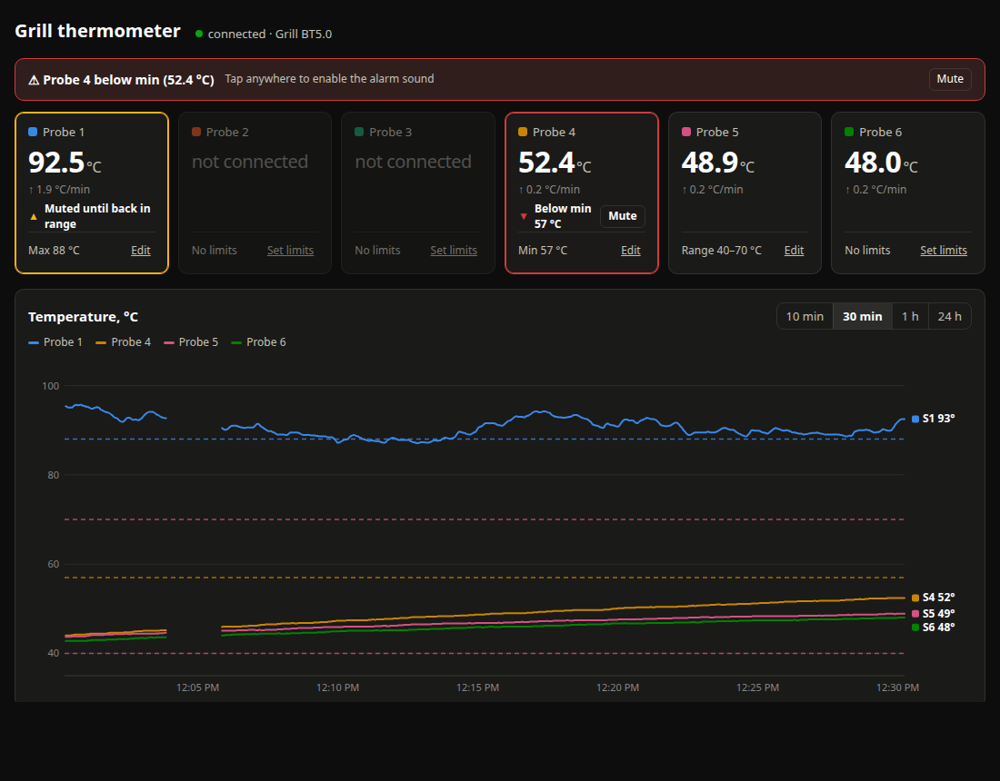

# Grill5.0 BLE thermometer → local web dashboard

Read a Bluetooth grill thermometer that normally needs the **Grill5.0** phone app, directly from a Linux computer —
no phone, no app, no cloud. You get a local web page with live temperatures for all six probes and a chart,
and every reading is logged to CSV.



| File | Purpose |
|---|---|
| `grill_web.py` | The service: keeps the BLE connection alive, logs readings, serves the web page (port 8080) |
| `grill_web.html` | The page: probe tiles, chart, table; new readings are pushed from the server (SSE) |
| `grill_cli.py` | Minimal command-line reader that prints temperatures to the terminal (handy for debugging) |
| `install.sh` | Installs required packages and a systemd user service, then starts it |
| `grill.env.example` | Example settings (port, bind address, MAC, log directory) |
| `tools/dexdis.py` | Tiny Android `.dex` disassembler used to extract the protocol from the app |

No pip packages are needed — only the distro packages `bluez`, `python3-dbus`, `python3-gi` and the Python standard library.

---

## 1. Quick install

Requirements: Linux (tested on Ubuntu 24.04) with a Bluetooth 4.0+ adapter (BlueZ) and Python 3.

```bash
git clone https://github.com/allanpolluste/grill5-ble.git
cd grill5-ble
./install.sh
```

`install.sh`:
1. installs `bluez python3-dbus python3-gi` if missing (asks for your `sudo` password);
2. powers on Bluetooth;
3. creates a **systemd user service** `~/.config/systemd/user/grill.service` pointing at the directory the script lives in;
4. enables *linger*, so the service also starts at boot without anyone logging in.

Then open **http://localhost:8080**.
From a phone on the same network, open `http://<computer-IP>:8080`. You can find the IP with `hostname -I`.

To uninstall, run `./install.sh uninstall`. Your files and logs are kept.

## 2. Everyday use

Just switch the thermometer on. The service keeps scanning and connects within about 5–10 seconds.

| Action | Command |
|---|---|
| Status | `systemctl --user status grill` |
| Live log | `journalctl --user -u grill -f` |
| Restart | `systemctl --user restart grill` |
| Stop (e.g. to let the phone app connect) | `systemctl --user stop grill` |
| Start again | `systemctl --user start grill` |

**The thermometer accepts only one connection at a time.**
- While the service is connected, the Grill5.0 phone app cannot connect.
- While the app is connected, the service cannot find the thermometer.

The web page shows:
- one tile per probe, with the current temperature and its rate of change (°C/min);
- a chart, where you can pick a 10 min, 30 min, 1 h or 24 h window;
- a table of the latest readings.

Hover over the chart (or touch it on a phone) to see every probe's value at that moment.
When the thermometer is off, the tiles fade and the page shows how long ago the last reading arrived.

### Alarms (min / max per probe)

Each probe tile has a **Set limits** button. Enter a min, a max or both, in °C. Leaving a field empty means that side has no limit.

- When a reading **leaves the range**, the alarm goes off:
  - the tile turns red and pulses;
  - a banner appears at the top;
  - the browser beeps (phones also vibrate);
  - the tab title flashes.
- **Mute** silences that probe's alarm. The tile turns yellow and reads "Muted until back in range".
- A muted alarm re-arms only after the reading **comes back inside the range**. To count as back inside, the reading must be at least 1 °C past the limit, so jitter right at the limit doesn't count. For very narrow ranges this margin is a quarter of the range. The **next** time the reading leaves the range, the alarm sounds again.
- Limits are drawn on the chart as dashed lines in the probe's colour.
- Limits are stored on the server in `~/.config/grill/alarms.json`, and alarms are evaluated by the server. Every open page shows the same limits and the same mute state, whether it is on a laptop or a phone.
- Unplugging a probe clears its alarm.

> Browsers only allow sound after the page has been touched or clicked once. If the banner says "Tap anywhere to enable the alarm sound", do that once.
> Keep the page open on the device that should make noise.

**Logs** are written to `~/grill_logs/grill_YYYY-MM-DD.csv`, one file per day. The columns are `time,S1..S6`. An empty cell means the probe was not plugged in.
After a restart, the last 24 hours are reloaded from the logs, so the chart continues where it left off.

## 3. Settings

Copy `grill.env.example` to `grill.env`, edit it, then restart the service with `systemctl --user restart grill`.

| Variable | Default | Meaning |
|---|---|---|
| `GRILL_PORT` | `8080` | Web server port |
| `GRILL_HOST` | `0.0.0.0` | `0.0.0.0` makes the page visible on the local network. `127.0.0.1` restricts it to this computer |
| `GRILL_MAC` | (empty) | Connect to one specific thermometer. If empty, the service connects to the first device whose name starts with `Grill` |
| `GRILL_LOG_DIR` | `~/grill_logs` | Directory for the CSV logs |
| `GRILL_CONFIG_DIR` | `~/.config/grill` | Directory for alarm limits (`alarms.json`) |

You can also pass the same settings on the command line: `python3 grill_web.py --port 8080 --host 127.0.0.1 --mac AA:BB:.. --logs ~/dir`.

## 4. Troubleshooting

| Symptom | What to do |
|---|---|
| Page stays at "searching for thermometer" | Make sure the thermometer is on and the phone app is closed. Then check that it is visible with `bluetoothctl --timeout 10 scan on`. Look for a device named `Grill BT5.0` |
| Thermometer is visible but never connects | Run `bluetoothctl remove <MAC>`, then `systemctl --user restart grill` |
| Bluetooth is off | Run `bluetoothctl power on`. If the adapter is blocked, run `rfkill unblock bluetooth` |
| The page does not open from a phone | Check that `GRILL_HOST=0.0.0.0` is set and that the firewall allows the port, e.g. `sudo ufw allow 8080/tcp` |
| The service does not start after a reboot | Run `loginctl show-user $USER -p Linger`. It should print `Linger=yes`. If it doesn't, run `sudo loginctl enable-linger $USER` |
| You want to test without the service | `systemctl --user stop grill; python3 grill_cli.py` |
| A probe shows "not connected" | The thermometer sends `-1` when a probe plug is not fully inserted |

---

## 5. Protocol

The protocol was extracted from the Android app **Grill5.0** (`com.irainxun.grilltempsense`, version 1.5.1, classes `BleHelper` and `BleHelper$6`).
It was tested with a device advertising as `Grill BT5.0`.

| | |
|---|---|
| Advertised name | starts with `Grill` (the app filters scan results with `name.startsWith("Grill")`) |
| Service | `0000FFB0-0000-1000-8000-00805f9b34fb` |
| Write (commands) | `0000FFB1-…`, write with response |
| Notify (data) | `0000FFB2-…`, enabled through CCCD `0x2902` |
| Pairing | not required |

**Data starts flowing as soon as notifications on `FFB2` are enabled**, roughly every 2.5–3 s. No start command is needed.

### Packets (device → host, `FFB2`)

Every packet starts with `0x55`. Byte 1 is the packet type.

| Byte 1 | Content |
|---|---|
| `0x00` | **Live temperatures:** bytes 2..13 hold 6 × `int16`, big-endian and signed, for probes 1..6. Divide the value by 10 to get °C. `-1` (`FF FF`) means no probe |
| `0x04` | Unit response: byte 2 = 1 means success; byte 3 = 1 means °C and 2 means °F |
| `0x05` | Alarm temperatures: byte 2 = 1 means the maximums, anything else the minimums. Bytes 3.. hold 6 × `int16` BE |
| `0x06` | Timers: if byte 2 = 1, the packet is only an acknowledgement. Otherwise bytes 3.. hold 6 × `int16` BE, in seconds |
| `0x01`, `0x02`, `0x03`, `0x07` | Command acknowledgements (status in byte 2) |

Example: `55 00 03 7a ff ff ff ff 01 7d 01 8a 01 83` decodes to S1 = 89.0 °C, S2 and S3 not connected, S4 = 38.1 °C, S5 = 39.4 °C and S6 = 38.7 °C.

### Commands (host → device, `FFB1`)

The last byte is the 8-bit wrapping sum of all previous bytes.

| Command | Bytes |
|---|---|
| Realtime data on | `55 1F 01 75` |
| Realtime data off | `55 1F 02 76` |

The app has further commands to set the unit, alarms, timers and the clock (`setTempUnit`, `setAlarmTemp`, `setTimer`, `syncTime`). These change settings on the thermometer. This project does not use them; it only reads.

## 6. How the protocol was found (if you need to redo it)

Written for both humans and AI coding agents who need to do the same for another thermometer or a new app version.

1. **Find the device.** Run `bluetoothctl --timeout 15 scan on`, then `bluetoothctl devices`. Switch the thermometer off and on again and watch which entry appears.
   - *Pitfall:* a connected BLE device stops advertising. Close the phone app first.
   - *Pitfall:* there may be look-alike devices nearby. In our case a `BS38182B0A40C4H` with service `CDF0` was close by and was **not** the thermometer. The right device is the one whose name matches the app's scan filter (see step 3).
2. **Inspect the GATT services:** run `bluetoothctl connect <MAC>`, then `bluetoothctl gatt.list-attributes <MAC>`.
3. **Read the protocol from the app.**
   - Download the APK in a browser (APKPure blocks scripted downloads with a Cloudflare check) and unzip it: `unzip app.apk -d x`.
   - Find the UUIDs: `grep -aoE '[0-9a-fA-F]{8}-[0-9a-fA-F]{4}-[0-9a-fA-F]{4}-[0-9a-fA-F]{4}-[0-9a-fA-F]{12}' x/classes*.dex | sort -u`.
   - Disassemble the Bluetooth classes:
     `python3 tools/dexdis.py x/classes.dex Lcom/irainxun/grilltempsense/bluetooth/ > bt.txt`.
     This needs only the Python standard library. If Java is available, [jadx](https://github.com/skylot/jadx) works too.
   - Look at these places in the output:
     - `onScanResult` or `onLeScan` for the name filter;
     - `<clinit>` for the UUIDs;
     - `onCharacteristicChanged` for packet decoding;
     - methods that call `writeCharacteristic` for the commands and checksum.
4. **Test** with `python3 grill_cli.py`, or `python3 grill_cli.py <MAC>` for a specific device.

**Dead ends** (so nobody has to repeat them):
- The AT-02 / ToGrill protocol (service `CEE0`, commands `55 AA …`) belongs to a different device family.
- The Oregon Scientific Web Bluetooth example (service `2899FE00-…`) is a different device as well.

## 7. Architecture

```
thermometer --BLE notify FFB2--> BlueZ (bluetoothd) --D-Bus--> grill_web.py
                                                                ├─ GLib main loop: connect, auto-reconnect, watchdog (30 s without data → reconnect)
                                                                ├─ CSV log ~/grill_logs/
                                                                └─ HTTP thread :8080
                                                                     ├─ GET /             → grill_web.html
                                                                     ├─ GET /api/history  → {status, history:[[ts,[t1..t6]],…]} (last 24 h)
                                                                     ├─ GET /api/stream   → SSE: {type:"reading",t,v} | {type:"status",…} | {type:"alarms",…}
                                                                     ├─ POST /api/limits  ← {probe:1..6, min:number|null, max:number|null}
                                                                     └─ POST /api/mute    ← {probe:1..6} or {all:true}
```

- Status `code` values are `searching`, `connecting`, `connected`, `lost` and `error`.
- Each probe's alarm has the form `{min, max, state: "ok"|"high"|"low", muted}`.
- `/api/history` also returns the current `alarms`.
- Anyone who can open the page can change limits. Set `GRILL_HOST=127.0.0.1` if your network is not trusted.

## Disclaimer

This is an independent project. It is not affiliated with or endorsed by the thermometer's manufacturer or by the Grill5.0 app developers.
The protocol description was obtained by analysing the publicly available app for interoperability purposes. No app code is included in this repository.

## License

[GPL-3.0](LICENSE). You may use, modify and share this project; modified versions you distribute must stay open source under the same license.
